<div align="center">


# KINOVO

### From idea to production.

**A self-hosted creative operating system for image, video, commerce, storytelling and spatial design.**

把创意、模型、素材、Agent 与生产流程，放进同一个工作台。

[Product Tour](#product-tour) · [Architecture](#architecture) · [Quick Start](#quick-start) · [Documentation](#documentation) · [中文介绍](#kinovo-是什么)

[](https://github.com/Versior/open-ai-canvas/stargazers)
[](LICENSE)
[](https://github.com/Versior/open-ai-canvas/commits/feat/ecommerce-canvas)
[](web/package.json)
[](backend/go.mod)

<br>

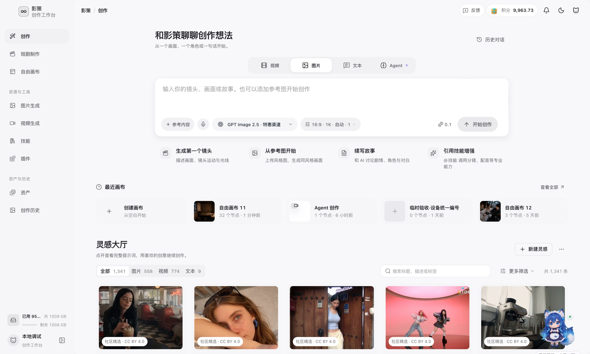

</div>

> [!IMPORTANT]
> KINOVO 正在快速迭代，数据结构和外部接口可能调整。默认适合个人、本地或可信环境部署；公网多人使用前，请先完成安全配置。

## KINOVO 是什么

KINOVO 是一套可自部署的多模态 AI 创作与内容生产系统。它不是单一的生图页，也不是只会聊天的 Agent，而是一条从构想到交付的完整生产链。

图片、视频、短剧、电商视觉、视频复刻、室内设计和 3D 预演共享同一套模型渠道、素材库、任务系统与管理后台。创作者可以从一句话开始，也可以在无限画布里精细控制每一步。

### From fragmented tools to one production system

| Layer           | What KINOVO connects                                 |
| --------------- | ---------------------------------------------------- |
| **Create**      | 文本、图片、视频、音频、字幕、配音和 3D 内容         |
| **Orchestrate** | 无限画布、Agent、Skills、插件和可审批的生成操作      |
| **Produce**     | 短剧流水线、电商套图、视频复刻、时间线和空间预演     |
| **Operate**     | 模型渠道、任务队列、素材、存储、用户、积分和运行质量 |

## Highlights

<table>
<tr>
<td width="50%" valign="top">
<h3>◈ Infinite Canvas + Agent</h3>
用节点和连线组织文本、图片、视频、音频与 3D 内容。Agent 能读取画布上下文、调用 Skills，并在审批后执行生成操作。
</td>
<td width="50%" valign="top">
<h3>◈ Multi-model Production</h3>
统一接入文本、图片、视频和音频模型。按供应商、协议、规格、成本与售价管理渠道，不把工作流锁死在单一平台。
</td>
</tr>
<tr>
<td width="50%" valign="top">
<h3>◈ Story & Short Drama</h3>
从小说或正文生成剧本、角色、场景、分镜和视频片段。支持人工接管、设定锁定、镜头连续性和成片导出。
</td>
<td width="50%" valign="top">
<h3>◈ Commerce Studio</h3>
从商品事实和参考素材出发，完成视觉策划、视角方案、主图、详情页、营销 KV 与多平台套图生产。
</td>
</tr>
<tr>
<td width="50%" valign="top">
<h3>◈ Video Replication</h3>
拆解参考视频的镜头、字幕、声音与节奏，生成可编辑时间线，并输出成片或剪映草稿。
</td>
<td width="50%" valign="top">
<h3>◈ Spatial Design & Previs</h3>
面向室内设计、场景搭建和镜头预演，管理空间参考、角色动作、摄影机与时间轴，输出构图、白模和深度参考。
</td>
</tr>
</table>

## Product Tour

### Create from one place

<table>
<tr>
<td width="50%"></td>
<td width="50%">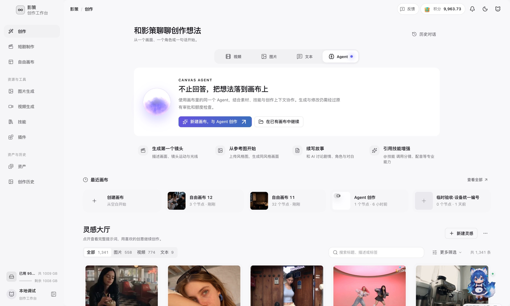</td>
</tr>
<tr>
<td><b>Create</b> — 从图片、视频、文本或 Agent 模式开始，选择模型、比例、清晰度与参考素材。</td>
<td><b>Agent</b> — 把需求变成画布任务，让 Agent 结合上下文、Skills 和素材继续推进。</td>
</tr>
</table>

### Build visually

<table>
<tr>
<td width="50%">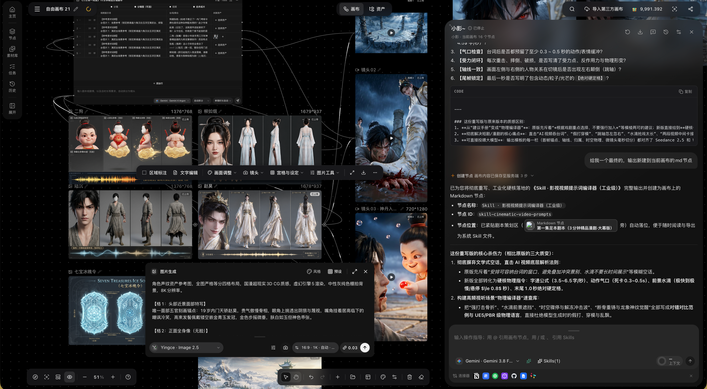</td>
<td width="50%">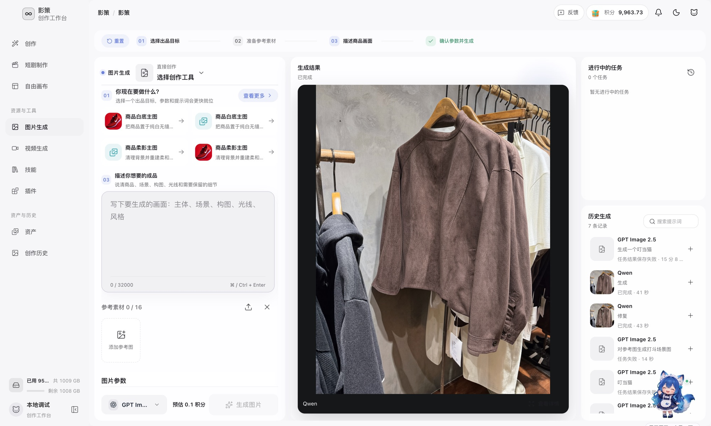</td>
</tr>
<tr>
<td><b>Canvas</b> — 节点、连线、分组、小地图、撤销重做、第三方画布导入与只读分享。</td>
<td><b>Image Studio</b> — 围绕出品目标管理模板、参考素材、生成参数、当前任务和历史结果。</td>
</tr>
</table>

### Move from story to screen

<p align="center">
  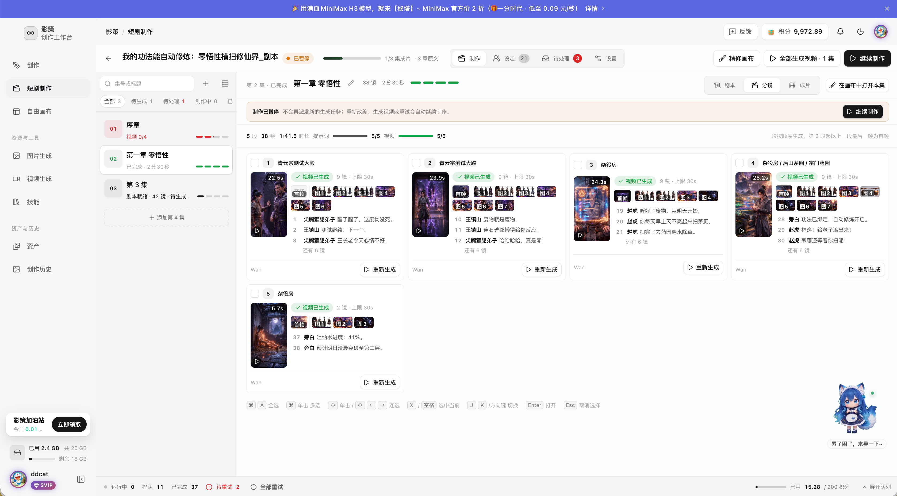
</p>

<table>
<tr>
<td width="50%">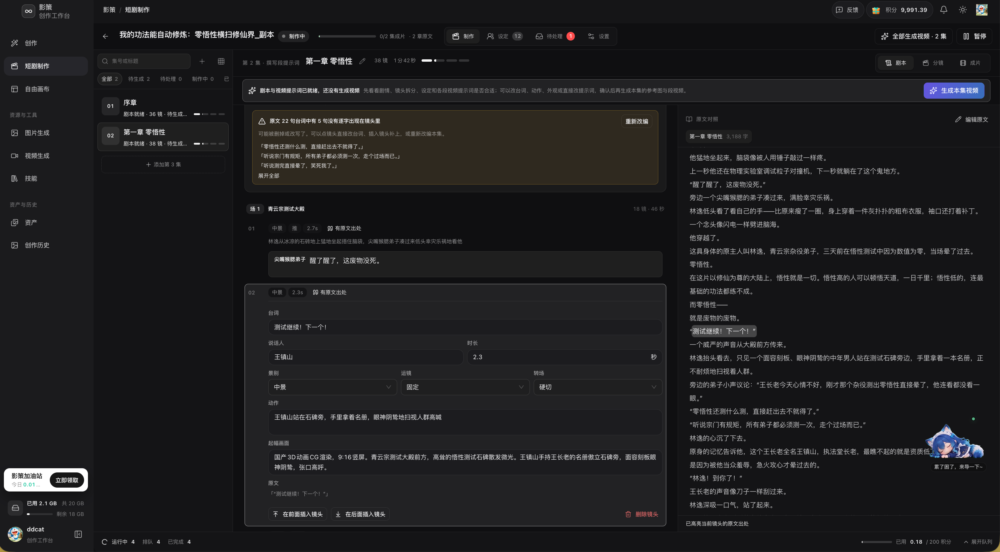</td>
<td width="50%">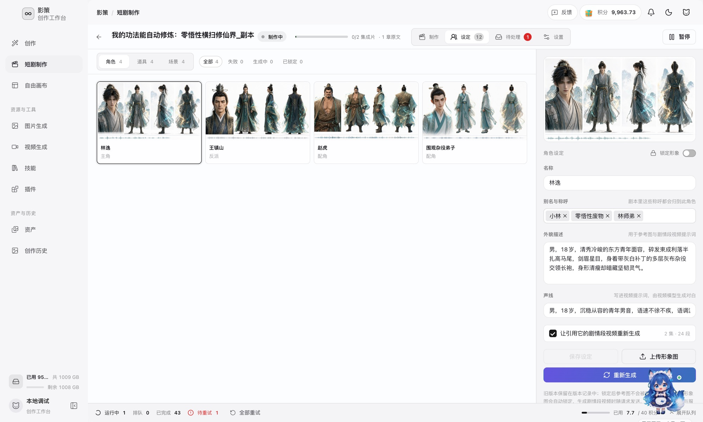</td>
</tr>
<tr>
<td><b>Script</b> — 管理分集、梗概、钩子、悬念、镜头、台词和对应原文。</td>
<td><b>World Bible</b> — 集中管理角色、道具和场景，锁定设定并跨镜头复用。</td>
</tr>
</table>

### Design the space before generation

<p align="center">
  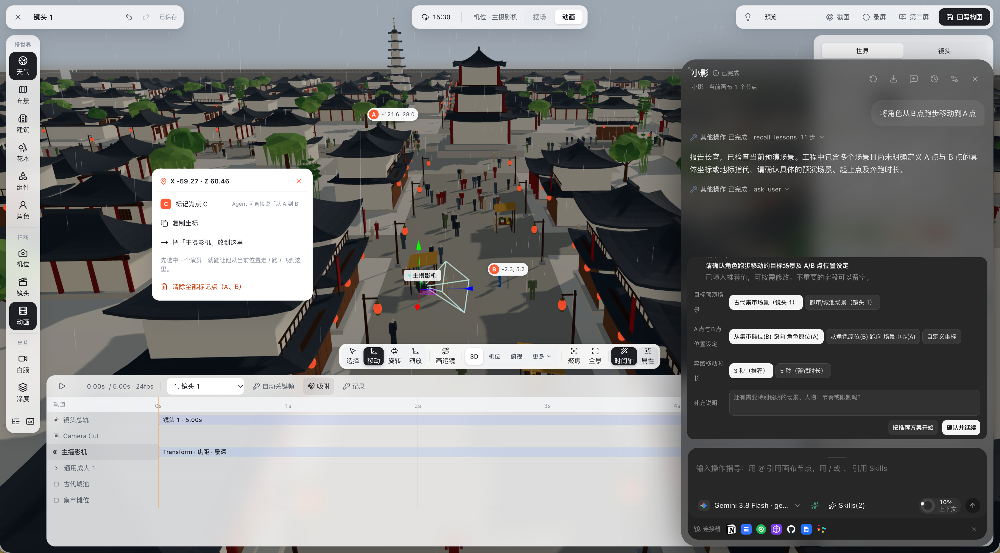
</p>

KINOVO 的 3D 预演台用于摆场、姿态、动画、摄影机和时间轴设计。构图截图、白模视频与深度图可以继续作为图片或视频模型的控制参考。

### Keep models, assets and operations together

<table>
<tr>
<td width="50%">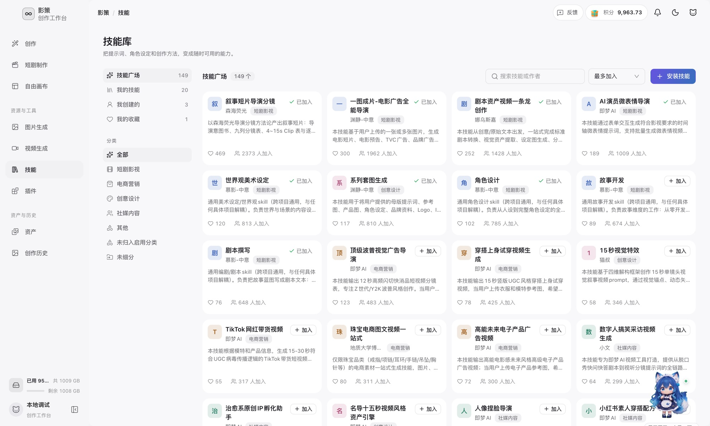</td>
<td width="50%">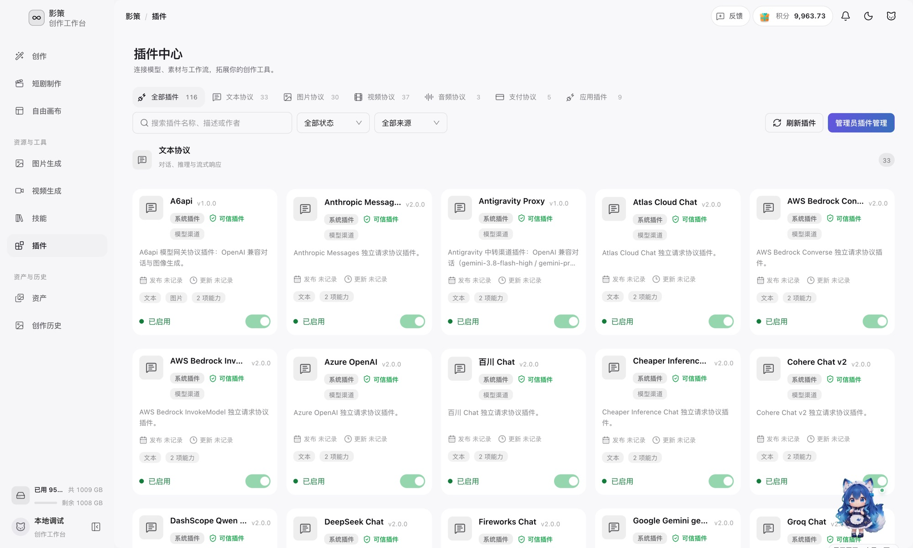</td>
</tr>
<tr>
<td><b>Skills</b> — 把分镜方法、角色设计、电商策划和创意经验沉淀为可调用能力。</td>
<td><b>Plugins</b> — 扩展模型协议、编辑器、媒体转换、支付与应用能力。</td>
</tr>
<tr>
<td>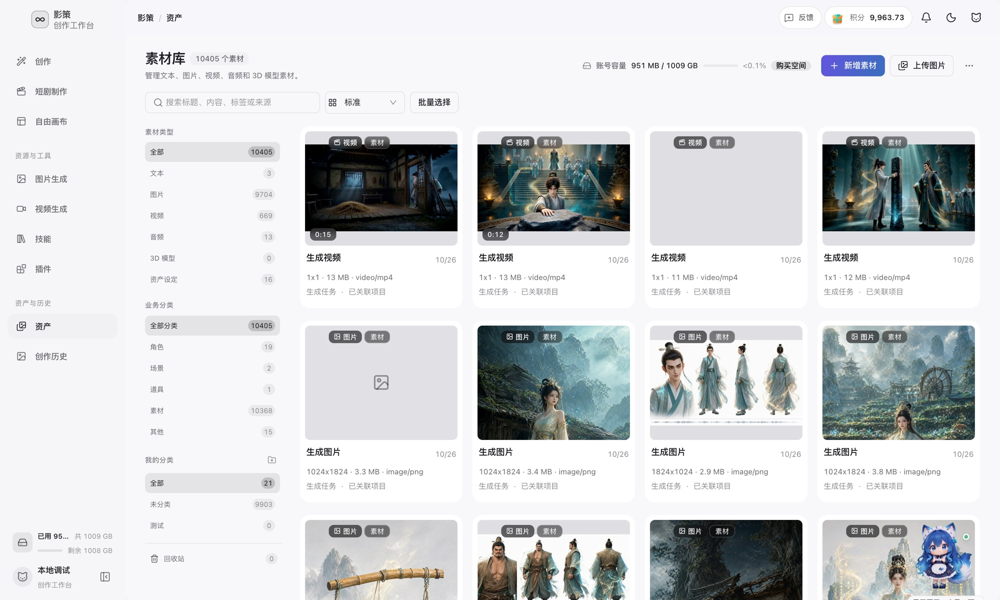</td>
<td>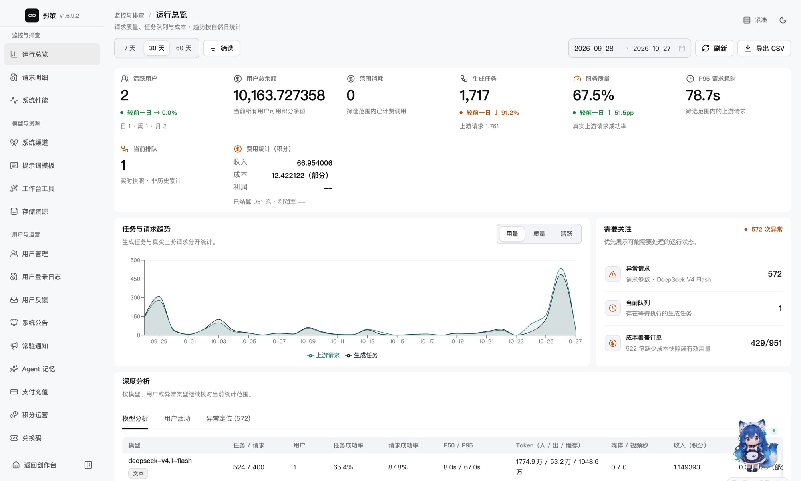</td>
</tr>
<tr>
<td><b>Assets</b> — 统一归档上传素材和生成结果，按业务类型组织，并在删除前检查引用。</td>
<td><b>Operations</b> — 查看任务量、成功率、P95 耗时、费用、收入与异常请求。</td>
</tr>
</table>

## Production Flow

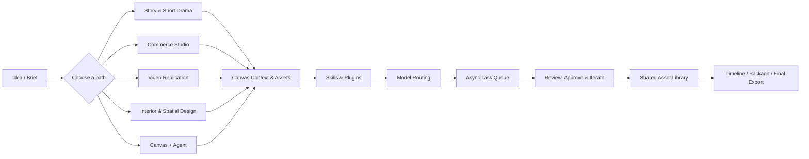

从业务入口到最终交付，所有路径复用同一套上下文、模型路由、异步任务和素材资产。这样既能快速开始，也能保留生产级的可追踪性。

## Architecture

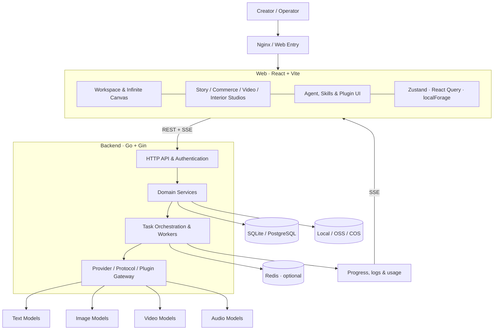

### Responsibility map

| Area                | Responsibility                                          |
| ------------------- | ------------------------------------------------------- |
| `web/`              | React 工作区、画布、各类 Studio、管理后台和浏览器端状态 |
| `backend/`          | 鉴权、业务服务、任务编排、模型中转、存储、计费和审计    |
| `docs/`             | 产品、开发、数据库、画布和插件系统文档                  |
| Docker & Compose    | Nginx、前后端容器和生产部署边界                         |

## Technology Stack

| Layer          | Main technologies                                                    |
| -------------- | -------------------------------------------------------------------- |
| Frontend       | React 19, TypeScript, Vite, Zustand, TanStack Query, Ant Design      |
| Canvas & Media | Leafer, tldraw, Excalidraw, Three.js, PixiJS, FFmpeg                 |
| Backend        | Go 1.25, Gin, GORM, SSE, asynchronous workers                        |
| Data           | SQLite for local use; PostgreSQL and Redis for deployed environments |
| Storage        | Local filesystem, Alibaba Cloud OSS, Tencent Cloud COS               |
| Tooling        | Bun, ESLint, Prettier, Go test, Docker Compose, Nginx                |

## What is different in this fork

KINOVO 基于 Open AI Canvas 持续二次开发，将原本偏影视的工作台扩展为多场景内容生产系统。

- **Commerce**：商品事实、视觉策划、视角方案、主图、详情页、营销 KV 和平台套图。
- **Replication**：镜头分析、字幕、配音、音乐、时间线、成片与剪映草稿。
- **Spatial Design**：室内设计参考、场景搭建、摄影机和 3D 预演。
- **Agent & Canvas**：更完整的画布 Agent、Skills、插件、素材和审批链路。
- **Operations**：模型渠道、成本售价、任务质量、用户、积分、存储和公告管理。
- **Compatibility**：保留旧存储键、插件协议、导入格式和部署变量，避免破坏现有数据。

当前开发分支为 [`feat/ecommerce-canvas`](https://github.com/Versior/open-ai-canvas/tree/feat/ecommerce-canvas)。

## Quick Start

### Requirements

- [Docker](https://docs.docker.com/get-docker/) + Docker Compose，或
- [Bun 1.3.9](https://bun.sh/) + [Go 1.25](https://go.dev/)

### Docker Compose

```bash
git clone -b feat/ecommerce-canvas https://github.com/Versior/open-ai-canvas.git kinovo
cd kinovo
docker compose -f docker-compose.local.yml up -d --build
```

构建完成后打开 <http://localhost:3000>。首次使用时注册管理员账号，然后在后台配置模型渠道。

> [!TIP]
> 本地构建编排只暴露 Web 端口，后端保留在 Compose 网络内。不要把后端 `8080` 端口直接暴露到公网。

### Local development

<details>
<summary><strong>展开宿主机开发步骤</strong></summary>

```bash
git clone -b feat/ecommerce-canvas https://github.com/Versior/open-ai-canvas.git kinovo
cd kinovo

mkdir -p .local/project-workbench-debug .local/cache/go-build .local/cache/go-mod

# Terminal 1 · Backend
cd backend
CANVAS_BACKEND_ADDR=127.0.0.1:8080 \
CANVAS_BACKEND_DATA_DIR=../.local/project-workbench-debug \
GOCACHE=../.local/cache/go-build \
GOMODCACHE=../.local/cache/go-mod \
go run ./cmd/server

# Terminal 2 · Web
cd ../web
bun install --frozen-lockfile
bun run dev
```

前端默认将 `/api` 代理到 `http://127.0.0.1:8080`。Windows PowerShell 用户也可以在仓库根目录执行 `./scripts/start-local.ps1`。

</details>

## Deployment & Security

- 公网部署保持 `CANVAS_REGISTRATION_ENABLED=false`，并在受控网络内完成首次管理员注册。
- 为 `CANVAS_CORS_ORIGINS` 配置准确来源，使用 HTTPS，并正确转发代理头。
- 仅通过 `CANVAS_ALLOWED_PRIVATE_UPSTREAM_HOSTS` 精确放行可信的私网模型服务。
- 不要在 URL、日志、Issue 或仓库中暴露 API Key、Cookie、数据库和生产配置。
- 限制 `.env`、数据库、上传目录、备份和 `.settings-key` 的文件权限。

完整部署方式、环境变量和安全边界请查阅[本地开发文档](docs/content/docs/backend/local-development.mdx)与[安全策略](SECURITY.md)。

## Documentation

| Guide                                                          | Description          |
| -------------------------------------------------------------- | -------------------- |
| [Quick Start](docs/content/docs/backend/local-development.mdx) | 本地启动和首次配置   |
| [Feature Map](docs/content/docs/overview/features.mdx)         | 完整功能清单         |
| [Code Map](docs/content/docs/backend/code-map.mdx)             | 入口、模块和调用关系 |
| [Database](docs/content/docs/backend/backend-database.mdx)     | 数据结构和持久化边界 |
| [Pose Library](docs/content/docs/canvas/pose-library.mdx)      | 姿势资产与画布说明   |
| [Plugin System](docs/content/docs/plugins/plugin-system.mdx)   | 插件协议和扩展方式   |
| [Changelog](CHANGELOG.md)                                      | 版本变化             |
| [Contributing](CONTRIBUTING.md)                                | 开发与贡献约定       |

### Validation

```bash
# Web
cd web && bun run lint && bun run build

# Backend
cd backend && go test ./...

# Documentation
cd docs && bun run types:check
```

## Upstream & License

KINOVO 基于 [Open AI Canvas](https://github.com/ddcat-ai/open-ai-canvas) / 影策二次开发。感谢原项目作者和所有贡献者提供的产品基础与开源工作。

本项目继续采用 [MIT License](LICENSE)。依据许可证要求，原版权声明完整保留：

> Copyright (c) 2026 ddcat and Open AI Canvas contributors

第三方组件、模型服务和素材遵循各自的许可证、服务条款与版权声明。

<div align="center">

**KINOVO — From idea to production.**

[Back to top](#kinovo)

</div>
